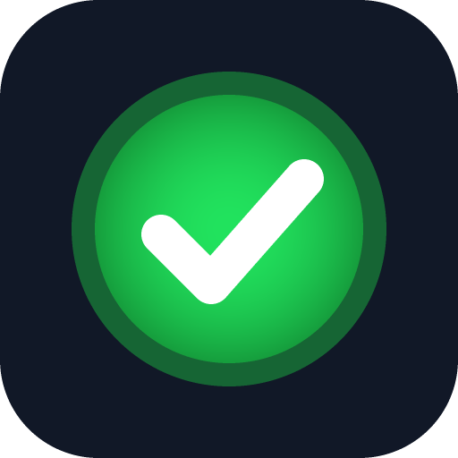

<p align="center">
  
</p>

<h1 align="center">Greenlight</h1>

<p align="center"><b>Get the green light from App Review before you hit Submit.</b></p>

<p align="center">
  
  
  
  
</p>

Greenlight is a [Claude Code](https://code.claude.com) plugin that audits your app against **every** [App Store Review Guideline](https://developer.apple.com/app-store/review/guidelines/), the way an App Reviewer would. It tells you what you **violate** and what you already **follow**, cites the `file:line` for each finding, scores your readiness, and helps you fix the problems, write your review notes, and recover from rejections.

```
🔴 REJECTION LIKELY · Readiness 41/100

❌ [BLOCKER] 5.1.1(v)  Sign-up without in-app account deletion   Sources/Auth/AuthService.swift:42
❌ [BLOCKER] 5.1.1     UserDefaults used, no privacy manifest      Sources/Settings/Prefs.swift:8
❌ [HIGH]    4.8       Google login, no Sign in with Apple         Sources/Auth/LoginView.swift:17
❌ [HIGH]    3.1.1     Subscriptions without Restore Purchases     Sources/Paywall/PaywallView.swift:30
🔎 [REVIEW]  5.1.2(i)  Sends user text to api.openai.com: needs explicit consent
✅ 2.5.5 IPv6-safe networking · ✅ 5.1.1(ii) All 6 purpose strings are specific · ✅ 2.5.4 Background modes justified …

Full report → GREENLIGHT_REPORT.md
```

## Commands

| Command | What it does |
|---|---|
| `/greenlight:audit` | 🟢 **Full audit.** Checks every guideline in Safety, Performance, Business, Design and Legal, plus upload requirements. Writes `GREENLIGHT_REPORT.md` with a verdict, score, ranked fixes, what you're doing right, and a full guideline matrix. |
| `/greenlight:preflight` | 🛫 **2-minute go/no-go** before Submit: Apple's "Before You Submit" list plus the top 10 rejection causes. |
| `/greenlight:privacy` | 🔐 **Privacy X-ray**: permission map, SDK and data-flow inventory, ATT, third-party AI sharing, account deletion, privacy policy, a drafted `PrivacyInfo.xcprivacy`, and drafted **App Privacy label** answers. |
| `/greenlight:paywall` | 💸 **Paywall check**: IAP vs Stripe, subscription disclosure, trials, Restore, Terms/Privacy links, US-storefront link rules, loot-box odds, dark patterns. One compliance card per paywall. |
| `/greenlight:metadata` | 🏷️ **Listing lint**: name/subtitle/keyword limits, banned terms, screenshots, and **claims vs code** (every feature you advertise is matched to code). |
| `/greenlight:rejected` | 🧯 **Rejection rescue**: paste Apple's message and get the root cause in your code, the fix, and a polite reply to App Review (or advice to appeal). |
| `/greenlight:notes` | 📝 **Review notes**: ready-to-paste App Review notes (demo access, IAP locations, permission reasons) under the 4,000-character limit. |
| `/greenlight:explain` | 📖 **Explain a guideline**: `/greenlight:explain 4.8` gives plain English, what reviewers test, triggers, exemptions, and code. With no argument it shows the command menu. |

You don't have to remember the commands. Ask Claude *"is my app ready for the App Store?"* or *"Apple rejected us under 5.1.1, help"* and the right skill runs.

## Install

**From GitHub (recommended):**

```bash
claude plugin marketplace add junaiiiid/greenlight
claude plugin install greenlight@greenlight
```

Or inside a Claude Code session:

```
/plugin marketplace add junaiiiid/greenlight
/plugin install greenlight@greenlight
```

**From a local clone (for development):**

```bash
git clone https://github.com/junaiiiid/greenlight
claude --plugin-dir ./greenlight
```

Requirements: Claude Code and `python3` (preinstalled on macOS with Xcode Command Line Tools). No other dependencies.

## Usage

Open Claude Code in your app's repository:

```
/greenlight:preflight          # quick go/no-go
/greenlight:audit              # everything, writes GREENLIGHT_REPORT.md
/greenlight:audit ./ios        # audit a sub-folder
/greenlight:paywall
/greenlight:rejected  <paste the App Review message>
/greenlight:explain 3.1.1(a)
```

Greenlight never edits your code without asking. It reports first, then offers to fix.

## How it works

```
 ┌──────────────────────┐   ┌─────────────────────────────┐   ┌──────────────────────┐
 │ 1. Static scanner    │ → │ 2. Guideline-by-guideline   │ → │ 3. Report            │
 │ 66 rules, file:line  │   │    review by Claude         │   │ verdict · score      │
 │ evidence in seconds  │   │ reads flows, SDKs, config,  │   │ ranked fixes · passes│
 │ (Python, stdlib)     │   │ metadata; checks freshness  │   │ guideline matrix     │
 └──────────────────────┘   └─────────────────────────────┘   └──────────────────────┘
```

1. **Scanner** ([`scripts/greenlight_scan.py`](scripts/greenlight_scan.py)): fast, deterministic checks for problems you can see in source and config. Each rule ends up ❌ fail, ✅ pass (with proof), 🔎 needs a decision, or ❓ can't verify statically.
2. **Audit**: Claude builds an app profile (accounts, money, content, sensitive data, regulated areas), then walks the [checklist](references/checklist.md) covering every guideline from 1.1 to 5.6.4 plus Apple's upload requirements. It reads the real flows (onboarding, permission prompts, paywall, settings, report/block, delete account) and confirms every scanner hit before accepting it.
3. **Report**: the verdict and score use one published formula (below), every finding cites evidence, and anything only App Store Connect knows becomes a checkbox for you.

**Scoring:** `100 − 15×BLOCKER − 7×HIGH − 3×MEDIUM − 1×LOW` (failures only).
🔴 any blocker → *Rejection likely* · 🟡 any high → *At risk* · 🟢 otherwise → *Greenlit*.

### What the scanner catches

| Area | Checks |
|---|---|
| **Upload blockers** | Missing purpose strings for 19 protected resources (ITMS-90683) · Required Reason APIs without a privacy manifest (ITMS-91053) · App Store icon with an alpha channel (ITMS-90717) · No launch screen |
| **Privacy (5.1)** | No in-app account deletion · No privacy policy link · Vague or placeholder purpose strings · IDFA without ATT · Ad/attribution SDKs without ATT · Data sent to third-party AI (OpenAI, Anthropic, Gemini, …) · HealthKit use |
| **Login (4.8)** | Google/Facebook login without Sign in with Apple or an equivalent |
| **Money (3.x)** | IAP without Restore · Subscriptions without Terms of Use · Loot boxes without odds · Stripe/PayPal/checkout links · Crypto · Gambling |
| **Safety (1.x)** | UGC/chat without report or block · API secrets in the binary · ATS disabled |
| **Software (2.x)** | Private APIs and `App-Prefs:` URLs · Hot-patched code · OTA updates · Hard-coded IPv4 (IPv6 test) · Unused background modes · Dev/ngrok endpoints · Placeholder content · "Beta" in app name · Android/Google Play mentions · Self-quitting apps |
| **Design (4.x)** | Web-wrapper risk · Push-notification rules · Custom review prompts |

Supported stacks: **Swift, SwiftUI, UIKit, Objective-C, React Native, Expo, Flutter, Capacitor/Cordova** (Info.plist, Xcode-generated plist keys, `app.json`, `PrivacyInfo.xcprivacy`, Podfile.lock, Package.resolved, package.json, pubspec.yaml).

The scanner also runs on its own:

```bash
python3 scripts/greenlight_scan.py /path/to/YourApp
```

## Staying current with Apple

Apple updates the guidelines often. Greenlight's checklist is a snapshot of the guidelines **Last Updated October 16, 2026**. Each `/greenlight:audit` fetches Apple's page, compares the date, and applies any newer rules before auditing. To refresh the snapshot, update [`references/checklist.md`](references/checklist.md) and the date in the audit skill, then open a PR.

## Repository layout

```
.claude-plugin/
  plugin.json          plugin manifest
  marketplace.json     lets people install straight from this repo
  icon.png
skills/                one folder per /greenlight:<command>
  audit/ preflight/ privacy/ paywall/ metadata/ rejected/ notes/ explain/
references/
  checklist.md         every guideline → how to verify it, severity
  report-template.md   GREENLIGHT_REPORT.md layout and scoring
scripts/
  greenlight_scan.py   static scanner (Python 3.8+, stdlib only)
tests/
  test_scan.py         scanner self-check (builds sample apps in a temp dir)
```

## Contributing

```bash
python3 -m unittest discover tests     # scanner tests
claude plugin validate .               # plugin + marketplace manifests
```

To add a scanner rule, add one `Rule(...)` line in `scripts/greenlight_scan.py` (id, guideline, severity, title, trigger regex, regex that proves compliance, fix) and a case in `tests/test_scan.py`. Regexes only see your app's own code: `Pods/`, `node_modules/`, build output and test targets are skipped.

## Disclaimer

Greenlight is an independent project, not affiliated with or endorsed by Apple Inc. App Store, iOS and related names are Apple trademarks. The checklist paraphrases Apple's public guidelines for auditing purposes; [Apple's page](https://developer.apple.com/app-store/review/guidelines/) is the authority. Greenlight lowers rejection risk but can't guarantee approval. App Review has the final say.

## License

[MIT](LICENSE)
# greenlight
